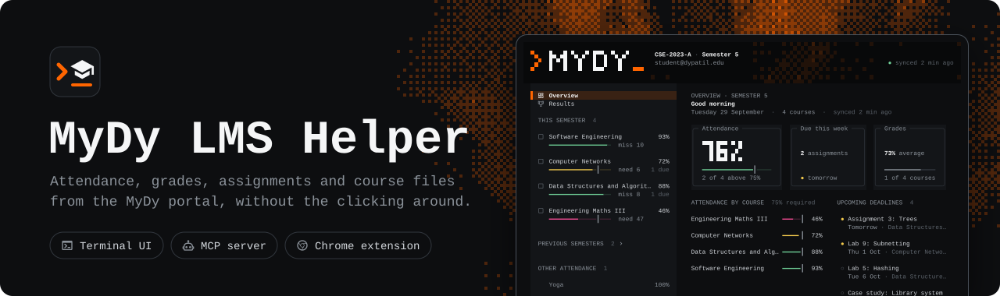
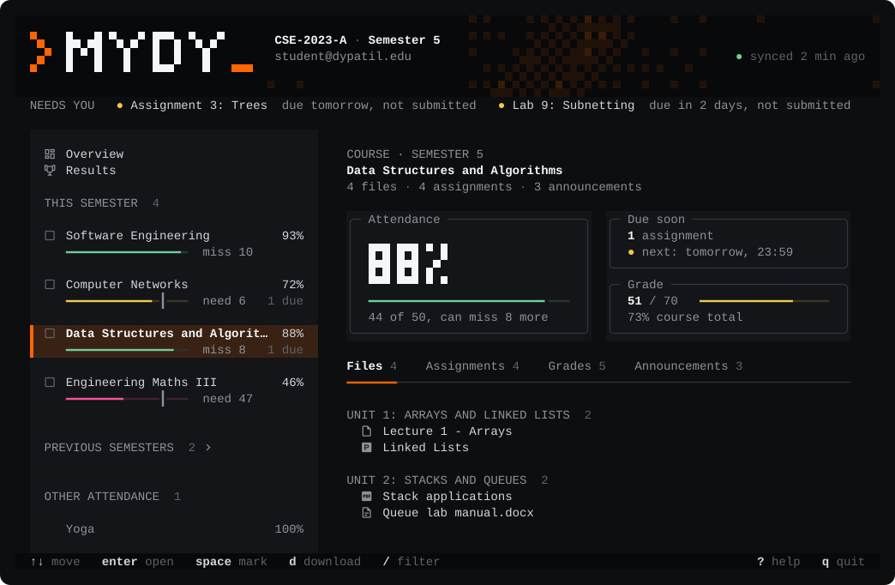
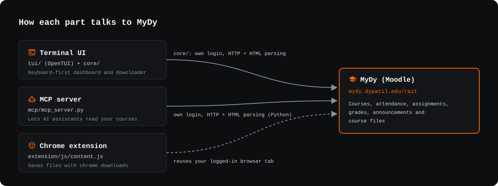

<div align="center">



<br>
<br>

**[Website and live demo](https://deeptanshuu.github.io/mydy-lms-helper/)** &nbsp;&nbsp;|&nbsp;&nbsp; **[Releases](https://github.com/Deeptanshuu/mydy-lms-helper/releases)**

</div>

<br>



MyDy, the D.Y. Patil LMS, in your terminal: attendance, deadlines and grades on one screen, every course's notes in one download, your SGPA and CGPA from UniClaIRE, and your AI assistant plugged into all of it.

| Part | What it does | Folder |
|---|---|---|
| **Terminal UI** | An overview of your semester, every course on one screen, your SGPA and CGPA, bulk downloads, works offline | `tui/` |
| **MCP server** | Ask Claude or any MCP client about your courses and results, and max your Course Progress | `mcp/` |
| **Chrome extension** | Download course files from the browser | `extension/` |

Each folder has its own README with setup and details.



## Quick start

macOS and Linux:

```sh
curl -fsSL https://deeptanshuu.github.io/mydy-lms-helper/install.sh | sh
```

Windows (PowerShell):

```powershell
irm https://deeptanshuu.github.io/mydy-lms-helper/install.ps1 | iex
```

Then run `mydy`. Binaries are also on [Releases](https://github.com/Deeptanshuu/mydy-lms-helper/releases), or run from source with [Bun](https://bun.com):

```sh
git clone https://github.com/Deeptanshuu/mydy-lms-helper.git
cd mydy-lms-helper && bun install && bun run tui
```

Contributing: see [CONTRIBUTING.md](CONTRIBUTING.md).

## License

MIT. Unofficial, not affiliated with D.Y. Patil or MyDy. Your logins are only sent to MyDy and UniClaIRE; only download what you already have access to.
