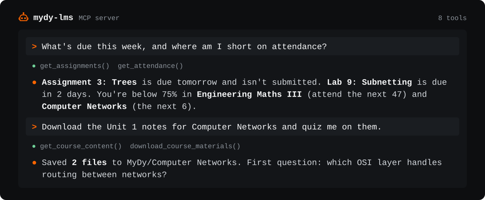

# MCP server

Lets Claude Code, Claude Desktop or any [MCP](https://modelcontextprotocol.io/) client read your MyDy courses, attendance, deadlines, grades and announcements, download your notes, work your Course Progress, and read your semester results from UniClaIRE. Part of [MyDy LMS Helper](../README.md).



## Set up

You need a copy of this repo and [uv](https://docs.astral.sh/uv/getting-started/installation/). uv installs the right Python and the server's packages by itself, the same way on macOS, Linux and Windows, so there's no virtualenv to manage.

```sh
git clone https://github.com/Deeptanshuu/mydy-lms-helper.git
cd mydy-lms-helper
```

**Claude Code** (run from the repo folder; `command -v uv` saves uv's full path, so it works whatever PATH the client sees):

```sh
claude mcp add mydy-lms -s user \
  -e MYDY_USERNAME=your_email@dypatil.edu \
  -e MYDY_PASSWORD=your_password \
  -- "$(command -v uv)" run --script "$PWD/mcp/mcp_server.py"
```

On Windows (PowerShell):

```powershell
claude mcp add mydy-lms -s user `
  -e MYDY_USERNAME=your_email@dypatil.edu `
  -e MYDY_PASSWORD=your_password `
  -- "$((Get-Command uv).Source)" run --script "$PWD\mcp\mcp_server.py"
```

**Other clients** (Claude Desktop, Cursor and others):

```json
{
  "mcpServers": {
    "mydy-lms": {
      "command": "/full/path/to/uv",
      "args": ["run", "--script", "/full/path/to/mydy-lms-helper/mcp/mcp_server.py"],
      "env": { "MYDY_USERNAME": "your_email@dypatil.edu", "MYDY_PASSWORD": "your_password" }
    }
  }
}
```

Use full paths: desktop apps don't see your terminal's PATH. `which uv` (macOS, Linux) or `where uv` (Windows) prints uv's. On Windows, write paths with forward slashes or doubled backslashes.

<details>
<summary>Without uv</summary>

```sh
python3 -m venv .venv
.venv/bin/pip install -r mcp/requirements.txt       # Windows: .venv\Scripts\pip install -r mcp\requirements.txt
```

Then use the virtualenv's Python as the command (`.venv/bin/python`, or `.venv\Scripts\python.exe` on Windows) with `mcp/mcp_server.py` as the argument, both as full paths.

</details>

The server is `mcp_server.py` plus two modules beside it, `lms_actions.py` and `uniclaire.py`; keep the three together.

## Tools

### MyDy

| Tool | Does |
|---|---|
| `login` | Sign in |
| `list_courses` | Every enrolled course |
| `get_semesters` | Courses grouped by semester |
| `get_course_content` | A course's sections and activities |
| `get_assignments` | Due dates and submission status |
| `get_grades` | A course's grade report |
| `get_announcements` | A course's announcements |
| `get_attendance` | This semester's attendance |
| `get_course_attendance` | Every class of one subject, present or absent |
| `download_file` | One activity's file |
| `download_course_materials` | Files from one, several or all courses |

### Course Progress

| Tool | Does |
|---|---|
| `get_hit_rates` | Each current course's Course Progress percentage and what's still pending (read-only) |
| `max_hit_rate` | Brings one course to 100%: opens every pending activity, posts an invisible placeholder to forums you haven't posted in, and solves quizzes (see below). Lists assignments still unsubmitted |
| `solve_quizzes` | Gives every quiz in a course a full-marks attempt: a throwaway attempt reveals the answers on its review page, a second attempt uses them. Skips quizzes with fewer than two attempts left |
| `submit_assignment` | Uploads a file to an assignment. Only for assignments `get_assignments` listed this session; won't replace an existing submission unless you explicitly ask |

`max_hit_rate`, `solve_quizzes` and `submit_assignment` act on your account: forum posts are visible to your class, and quiz attempts stay on your record. The server tells your assistant to check with you before using them.

### UniClaIRE results

UniClaIRE is a separate account: your registration number (usually your mobile number) and portal password. Add `-e UNICLAIRE_REGNO=... -e UNICLAIRE_PASSWORD=...` when you add the server (or put them in `env`), or let your assistant call `uniclaire_login`.

| Tool | Does |
|---|---|
| `uniclaire_login` | Sign in to UniClaIRE |
| `get_results` | SGPA for each semester, CGPA, and every subject's grade |
| `simulate_results` | What-if: SGPA and CGPA if some subjects had other grades (nothing is changed on the portal) |
| `check_revaluation_windows` | Whether the revaluation / re-totalling / photocopy window is open |
| `list_revaluation_applications` | Your revaluation applications |
| `get_revaluation_status` | One application's per-subject progress |
| `download_revaluation_form` | One application's printable PDF |

Try: *"What's due this week, and which subjects am I short on?"* or *"What's my CGPA, and which semester pulled it down?"* or *"If my DBMS revaluation comes back a C, what's my CGPA?"*
